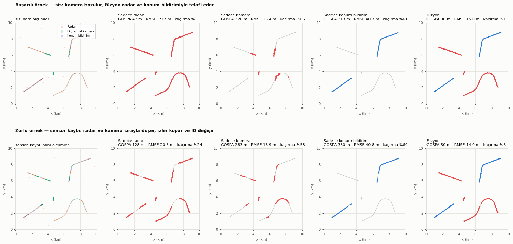
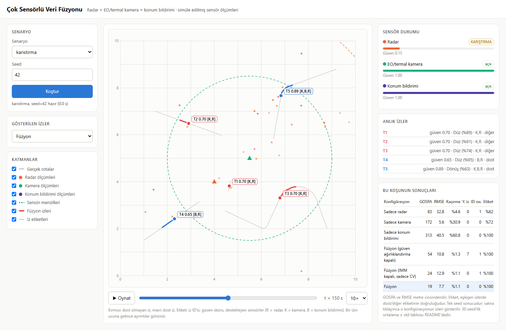
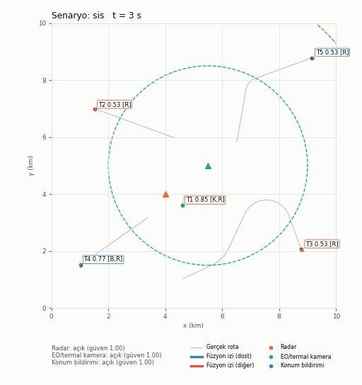
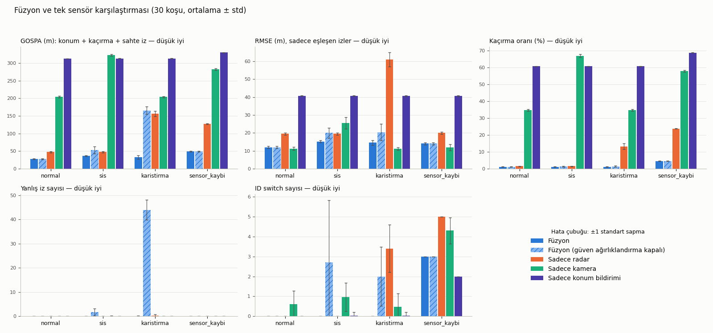

# Çok Sensörlü Veri Füzyonu

[](https://github.com/Goktugelbir/Cok-Sensorlu-Veri-Fuzyonu/actions/workflows/testler.yml)

*Harekât sahasında durumsal farkındalığın artırılması*

Radar, EO/termal kamera ve konum bildirimi sensörlerinden gelen simüle edilmiş
konum ölçümlerini birleştirerek tek bir **ortak durum resmi** oluşturan ve
füzyonun tek sensöre göre kazancını ölçen bir Python projesi [1, 5]. Sonuçlar ayrıca
yerel bir web arayüzünde etkileşimli olarak izlenebilir ([Web arayüzü](#web-arayüzü)).

> **Kısaca:** Bir sahada hareket eden beş hedefi üç farklı sensör izliyor:
> uzağı gören ama kaba ölçen bir radar, hassas ama sadece yakını gören bir
> kamera ve sadece dost birliklerin kendi konumunu bildirdiği bir sistem.
> Her biri tek başına eksik kalıyor: Radar gürültülü, kamera hedeflerin üçte
> birini hiç görmüyor, konum bildirimi dost olmayan hedefleri göremiyor. Bu proje, üç
> sensörün ölçümlerini birleştirip tek ve güvenilir bir "kim nerede" resmi
> çıkarıyor. Sis, radar karıştırma ve sensör arızası gibi durumlarda da
> çalışıyor. Sonuç olarak füzyon, genel başarım ölçütü GOSPA'da (konum
> hatası, kaçırılan ve sahte hedefler birlikte), dört senaryonun hepsinde ve
> 30 tekrarın 30'unda tek başına en iyi sensörden daha iyi bir durum resmi
> veriyor. Sadece konum hatasına bakan RMSE'de ise yakın hedefleri gören kamera
> çoğu senaryoda daha düşük kalıyor (bkz. [Yorum](#yorum)). Bu bulgu, ayarlamada hiç kullanılmamış ikinci bir 30'luk tekrar setinde de
> doğrulandı. Füzyon izleri ayrıca dost/diğer etiketini de her koşuda
> doğru taşıyor. Proje bir **simülasyon demosudur**; gerçek sensör verisi
> kullanmaz (bkz. [Sınırlamalar](#sınırlamalar)).

> **In English:** A Python demo that fuses simulated radar, EO/IR camera and
> blue-force position reports into a single tactical picture. It covers time
> alignment of delayed measurements, online bias estimation, Mahalanobis gating
> with optimal assignment, IMM (Interacting Multiple Model: Constant Velocity + EKF Coordinated Turn)
> filtering and NIS-based sensor trust. Across four scenarios (normal, fog, jamming, sensor loss)
> and 30 Monte Carlo runs, fusion beats the best single sensor in GOSPA in 30/30
> runs per scenario. The result is confirmed on a held-out seed set, and an
> ablation shows that sensor trust prevents false tracks under jamming.



*Üst satır (başarılı örnek, sis): Kamera sisten etkilenince tek başına hedeflerin
%65'ini kaçırıyor. Füzyon radar ve konum bildirimiyle bu açığı kapatıyor ve en
düşük RMSE'yi veriyor. Alt satır (zorlu örnek, sensör kaybı): Radar ve kamera
150-170 s arasında aynı anda kapalı kalıyor. Bu sürede sadece dost birlikler
izlenebiliyor; diğer hedeflerin izleri kopuyor ve geri geldiklerinde yeni ID
alıyor. Kırmızı: dost olmayan iz, mavi: dost iz, gri: gerçek rota.
Figür seed=42 örnek koşusundandır; istatistikler için [Sonuçlar](#sonuçlar).*

## Amaç

- 10 km x 10 km'lik bir sahada hareket eden 5 hedefi (2'si dost) farklı
  özelliklere sahip üç sensörle izlemek,
- sensör ölçümlerini zaman, bias ve güven açısından hizalayıp tek bir iz
  listesinde birleştirmek,
- füzyonun tek sensörlere göre kazancını dört senaryoda (normal, sis,
  karıştırma, sensör kaybı) sayısal olarak göstermek.

## Saha ve sensörler

| Hedef | Tür | Rota |
|---|---|---|
| Araç-1 | diğer | düz, sabit 10 m/s |
| İHA-1 | diğer | 22 m/s, uzun sola dönüş ve ardından sağa kırılma |
| İnsan Grubu | diğer | 1.15 m/s, hafif kıvrımlı (yaya grubu hızı: Moussaïd ve ark. [9]) |
| Dost Araç | **dost** | düz, hız değiştiren (8 → 16 → 5 m/s) |
| Dost İHA | **dost** | 18 m/s, 60° dönüş, ardından yavaşlama |

| Sensör | Konum / menzil | Gürültü (1σ) | Hız | Gecikme | Özel durum |
|---|---|---|---|---|---|
| Radar | (4, 4) km, 8 km | 12 m + 2 m/km | 1 Hz | 0.6-0.7 s | %90 tespit, tarama başına ~0.5 yanlış alarm; karıştırmada etki hedefin yönüne ve menziline bağlı (aşağıda) |
| EO/termal kamera | (5.5, 5) km, 3.5 km | 3 m + 4 m/km | 5 Hz | 0.3-0.35 s | tespit olasılığı hedef boyutu ve mesafeyle düşer (Johnson); sis: menzil x0.65, gürültü x3, tespit x0.5 |
| Konum bildirimi | sadece dostlar | 3 m | 0.5 Hz | 1.5-1.7 s | sabit bias (35, -20) m, kimlik taşır |

Sensörler aynı anda ölçmez (her birinin farklı bir faz kayması vardır). Her
ölçüm, sensörün beyan ettiği nominal gürültü kovaryansını taşır. Sis veya
karıştırma bu beyanı değiştirmez; bozulmayı füzyon merkezinin kendisi fark
etmek zorundadır.

**Kamera tespit modeli (Johnson kriterleri [10]).** Bir hedefin %50 olasılıkla
tespiti için kritik boyutu boyunca 1 çizgi çifti (~2 piksel) gerekir. Tespit
olasılığı P = x^E / (1 + x^E), E = 2.7 + 0.7x ile hesaplanır; x, hedefin
görüntüde kapladığı çizgi çifti sayısının bu eşiğe oranıdır. Kamera 1280 piksel
ve 10° yatay görüş açılı varsayılır. Kritik boyutlar: araç 2.3 m (NATO standart
araç hedefi), insan grubu 1.6 m, İHA 0.5 m. Bu yüzden kamera aracı 3.5 km'de
%98, İHA'yı 2 km'de %43 olasılıkla tespit eder. 3.5 km kameranın kapsama sınırı
olarak kalır.

**Radar karıştırma modeli (stand-off gürültü karıştırıcısı [11]).**
Karıştırıcı (7, 6.5) km'de, hedeflerden ayrı durur ve radarın gürültü tabanını
yükseltir.
- **Yöne bağlı:** Karıştırma/gürültü oranı (JNR) radarın karıştırıcıya bakan
  anten kazancına bağlıdır. Ana lobda 42 dB (2° hüzme, Gauss yaklaşımı), yan
  loblarda 30 dB daha düşük.
- **Menzile bağlı:** Hedefin SNR'ı radar denklemine göre menzilin 4. kuvvetiyle
  düşer (8 km'de 13 dB). Tespit olasılığı SINR'dan North yaklaşımıyla [12]
  hesaplanır; radara yakın hedefler karıştırmaya rağmen görülür (burn-through).
- **Ölçüm hatası:** √(1 + JNR) kat büyür; yan lobda ×4.1.
- **Sahte tespitler:** Karıştırıcı *yönündeki* gürültü şeridinde, rastgele
  menzillerde, tarama başına ortalama 6 sahte tespit oluşur.

## Yöntem

1. **Zaman senkronizasyonu:** Füzyon merkezi, en büyük gecikmeden uzun sabit
   bir pencere (2 s) kadar geriden çalışır. Pencere içindeki ölçümler alınış
   zamanına göre sıralanır, her taramadan önce bütün izler Kalman tahminiyle
   tam o ana taşınır ve sonunda 0.2 s'lik ortak zaman adımına hizalanır. Bu
   sayede gecikmeli ve sırası bozuk gelen ölçümler doğru anda işlenir [1].
2. **Bias düzeltme:** Konum bildirimindeki sabit sapma, radar ve/veya kamerayla
   desteklenen olgun izlere göre hesaplanan artıkların ağırlıklı ortalamasıyla
   kestirilir. Kestirim tamamlanana kadar bu ölçümler izi güncellemez; sadece
   kimlik etiketi ve bias örneği sağlar [1].
3. **İz ilişkilendirme:** Mahalanobis kapılama (χ², %99.9) [1] uygulanır;
   iz-ölçüm atama problemi `scipy.optimize.linear_sum_assignment` [4] ile
   çözülür. Bu fonksiyon Crouse'un [3] tarif ettiği en kısa artırma yolu
   yöntemini uygular; Macar algoritmasıyla aynı optimal atamayı bulur.
   Atanmayan ölçümden aday iz başlatılır; güven ağırlıklı 3 vuruşla iz onaylanır. Aday iz 2.5 s,
   onaylı iz 6 s güncellenmezse silinir. Çakışan çift izler birleştirilir [1].
4. **IMM (Interacting Multiple Model) Filtresi** [1, 2]**:** Manevralı ve düz giden hedefleri
   aynı anda etkin izlemek için Sabit Hız (CV: `[x, y, vx, vy]`) ve Genişletilmiş Kalman
   Filtresi (EKF) tabanlı Koordineli Dönüş (CT: `[x, y, vx, vy, ω]`) modelleri etkileşimli
   olarak birleştirilmiştir. Markov geçiş olasılıkları (TPM) ve ölçüm inovasyonlarının
   Gauss olabilirlikleri üzerinden model olasılıkları her adımda dinamik güncellenir.
   Hedef düz rotada ilerlerken CV modeli (%80+), dönüş manevralarında ise açısal dönüş hızını
   (ω) kestiren EKF CT modeli ağırlık kazanır. Durum ve kovaryanslar olasılık ağırlıklı
   birleştirilerek füzyon merkezine sunulur.
5. **Sensör güveni ve çelişki çözümü:** Her sensör için normalize inovasyon
   karesinin (NIS) [1, 6] hareketli ortalaması tutulur. Ortalama tolerans değerini (4)
   aşarsa sensörün güveni düşer ve ölçüm kovaryansı `R / güven` olarak
   büyütülür. Böylece karıştırılan radar ya da sisteki kamera, çelişkide daha
   az söz sahibi olur. Güveni düşük sensörün vuruşları da onaya daha az katkı
   verir, bu da karıştırmanın ürettiği sahte izleri engeller. Bu yaklaşım,
   ölçüm gürültüsü kovaryansını çevrimiçi kestiren uyarlamalı Kalman
   filtrelerinin [6] basitleştirilmiş bir biçimidir.
6. **İz güven skoru:** `1 - Π(1 - katkı_s · güven_s · e^{-Δt_s/5})`. Her iz, son
   3 saniyede kendisini destekleyen sensörlerin listesini taşır (animasyonda
   `[R,K,B]` = radar, kamera, konum bildirimi).

**Değerlendirme:** Füzyon zamanında her saniye onaylı izler gerçek hedeflere
optimal atamayla (`linear_sum_assignment`) eşlenir (eşik 250 m).

- **GOSPA** [8] (p = 2, α = 2, c = 250 m): Her anda eşleşen çiftlerin konum
  hatası ile kaçırılan ve sahte hedeflerin her biri için c²/2 cezası tek bir
  uzaklıkta toplanır; tablo zaman ortalamasını verir. Kapsama ve doğruluğu
  birlikte ölçtüğü için ana karşılaştırma ölçütüdür.
- **RMSE:** Sadece eşleşen iz-hedef çiftlerinin konum hatası (kaçırılan
  hedefleri cezalandırmaz).
- **Kaçırma oranı:** İz atanmamış (hedef, an) çiftlerinin oranı.
- **Yanlış iz:** Ömrünün yarısından fazlasında hiçbir hedefe eşlenmeyen iz.
- **ID switch:** Bir hedefi izleyen iz kimliğinin değişmesi.
- **Etiket doğruluğu:** Eşleşen (hedef, an) çiftlerinde izin dost/diğer
  etiketinin hedefin gerçek türüyle aynı olma oranı. Konum bildirimi desteği
  almamış bir iz "diğer" sayılır.

Tek sensör sonuçları, aynı füzyon hattının sadece o sensörle çalıştırılmasıyla
elde edilir.

## Kurulum

```bash
git clone https://github.com/Goktugelbir/Cok-Sensorlu-Veri-Fuzyonu.git
cd Cok-Sensorlu-Veri-Fuzyonu
python -m pip install -r requirements.txt
```

Python 3.10+ ile numpy, scipy, matplotlib ve pillow gerekir; testler için pytest.

## Çalıştırma

```bash
python main.py --senaryo sis        # tek senaryo: normal | sis | karistirma | sensor_kaybi
python main.py --hepsi              # tüm senaryolar, 30 seed (~3 dk, çok çekirdekli)
python main.py --hepsi --tekrar 5   # daha az koşu, daha hızlı
python main.py --hepsi --gif-yok    # animasyonsuz
python main.py --hepsi --ilk-seed 100 --gif-yok   # bağımsız doğrulama (seed 100-129)
python -m pytest                    # birim testleri
python web.py                       # web arayüzü: http://localhost:8000
```

Çıktılar `results/` klasörüne yazılır: `<senaryo>.gif`, `karsilastirma.png`,
`ozet.png`, `sonuclar.json`, `sonuclar.md`. Animasyonlar ve özet figür
`seed=42` örnek koşusundan, tablolar `seed=42…71` arasındaki 30 koşudan
üretilir. Tohumlar sabit olduğu için sonuçlar her çalıştırmada aynıdır.

**Hız:** 300 saniyelik bir senaryonun füzyonu tek çekirdekte 0.6-1.9 s sürer
(Python 3.11, 12 çekirdekli bir dizüstü bilgisayar; en yavaşı yanlış alarmların
yoğun olduğu karıştırma). Bu, gerçek zamandan yaklaşık 150-450 kat hızlı
demektir. Süre, örnek koşuda her senaryo için ekrana yazdırılır.

> **Not:** `--senaryo` ile tek senaryo çalıştırıldığında tablo ve grafik,
> dört senaryonun ortak dosyalarını ezmemek için senaryo adını taşıyan ayrı
> dosyalara yazılır: `karsilastirma_<senaryo>.png`, `sonuclar_<senaryo>.json`,
> `sonuclar_<senaryo>.md`. Bu dosyalar git'e eklenmez (`.gitignore`). Ortak
> `karsilastirma.png` ve `sonuclar.*` sadece `--hepsi` ile güncellenir.

## Web arayüzü



*Karıştırma senaryosu, t = 150 s: Radar "KARIŞTIRMA" durumunda ve füzyonun
ona verdiği güven 0.15'e düşmüş. Yanlış alarmlar (turuncu noktalar) haritada
görünüyor ama sahte ize dönüşmüyor. Tablodaki "güven ağırlıklandırma kapalı"
satırına göre aynı koşuda güven mekanizması kapatılınca 7 sahte iz oluşuyor;
satıra tıklanınca bu izler haritada görülebilir. (Ekran görüntüsü önceki
karıştırma modelinden alınmıştır; yeni modelde sahte tespitler karıştırıcı
yönündeki şeritte oluşur.)*

```bash
python web.py              # tarayıcıda http://localhost:8000 açılır (Ctrl+C ile durur)
python web.py --port 8080  # farklı port
python web.py --tarayici-acma  # tarayıcıyı otomatik açma
```

Sadece Python standart kütüphanesiyle (`http.server`) çalışan yerel bir
arayüz:

- Senaryo ve seed seçilip **Koştur**'a basılır. Beş konfigürasyon paralel
  koşturulur (~6 s); sonuçlar önbelleğe alınır.
- Harita oynat/durdur ve zaman çubuğuyla oynar (boşluk tuşu da çalışır). Gerçek
  rotalar, son 3 saniyenin ham ölçümleri, füzyon izleri ve sensör menzilleri
  ayrı katmanlar olarak açılıp kapatılabilir.
- Bir izin ucuna gelince ID, dost/diğer bilgisi, güven skoru, destekleyen
  sensörler, konum ve hız görünür.
- Sağdaki panel her sensörün anlık durumunu (açık / SİS / KARIŞTIRMA /
  KAPALI) ve füzyonun ona verdiği güveni gösterir.
- Sonuç tablosunda bir satıra tıklayınca o konfigürasyonun izleri gösterilir.
  Örneğin "güven ağırlıklandırma kapalı" seçilince karıştırmadaki sahte izler
  haritada görülür.
- Belirli bir an doğrudan açılabilir:
  `http://localhost:8000/#senaryo=karistirma&t=150&konfig=fuzyon_guvensiz`

## Örnek animasyon



Gri çizgiler gerçek rotaları, küçük renkli noktalar son 3 saniyenin ham
ölçümlerini, kalın çizgiler füzyon izlerini (ID, güven skoru, destekleyen
sensörler) gösterir. Kesikli daireler sensör menzilleridir; sis altında kamera
dairesi küçülür, kapalı sensör noktalı gri çizilir. Diğer senaryolar:
[normal](results/normal.gif) · [karistirma](results/karistirma.gif) ·
[sensor_kaybi](results/sensor_kaybi.gif)

## Sonuçlar

Her senaryo 30 farklı seed ile (42-71) koşturulmuştur; değerler
**ortalama ± standart sapma** olarak verilmiştir. Hedef rotaları sabit,
sensör gürültüsü, tespitler, yanlış alarmlar ve gecikmeler her seed'de
farklıdır. **Füzyon (güven ağırlıklandırma kapalı)** satırı bir ablasyondur:
aynı füzyon hattı, NIS tabanlı sensör güveni devre dışı bırakılarak (bütün
sensörlerin güveni 1'de sabit) çalıştırılmıştır.

Tabloyu okurken:

- Sis sadece kamerayı, karıştırma sadece radarı etkiler. Bu yüzden "sis / sadece
  radar" satırı "normal / sadece radar" ile, "karistirma / sadece kamera"
  satırı da "normal / sadece kamera" ile pratikte aynıdır.
- Konum bildirimi sadece dost birlikleri gördüğünden, beş hedeften üçünü hiç
  göremez. Kaçırma oranının alt sınırı bu yüzden %60'tır. Kameranın ~%35'lik
  kaçırması menzil dışında kalan hedeflerden ve uzaktaki küçük hedeflerin (İHA)
  düşük tespit olasılığından gelir.
- Radar ve kamera kimlik bilgisi taşımaz; bu sensörlerin izleri hep "diğer"
  etiketlidir. Etiket doğrulukları, gördükleri hedefler arasındaki dost
  olmayanların payıdır (radar: 3/5 = %60). Konum bildirimi sadece dostları
  gördüğü için %100 alır, ama hedeflerin %61'ini kaçırır.

| Senaryo | Konfigürasyon | RMSE (m) | GOSPA (m) | Kaçırma (%) | Yanlış iz | ID switch | Etiket doğruluğu (%) |
|---|---|---:|---:|---:|---:|---:|---:|
| normal | Sadece radar | 19.5 ± 0.6 | 47.4 ± 1.6 | 1.5 ± 0.1 | 0.0 ± 0.0 | 0.0 ± 0.0 | 60.0 ± 0.1 |
| normal | Sadece kamera | 11.2 ± 0.8 | 204.4 ± 2.8 | 34.9 ± 0.6 | 0.0 ± 0.0 | 0.6 ± 0.7 | 70.8 ± 0.4 |
| normal | Sadece konum bildirimi | 40.7 ± 0.2 | 313.3 ± 0.2 | 60.8 ± 0.1 | 0.0 ± 0.0 | 0.0 ± 0.0 | 100.0 ± 0.0 |
| normal | Füzyon (güven ağırlıklandırma kapalı) | 12.0 ± 0.6 | 28.0 ± 1.0 | 1.1 ± 0.1 | 0.0 ± 0.0 | 0.0 ± 0.0 | 100.0 ± 0.0 |
| normal | **Füzyon** | 12.0 ± 0.6 | 28.0 ± 1.0 | 1.1 ± 0.1 | 0.0 ± 0.0 | 0.0 ± 0.0 | 100.0 ± 0.0 |
| sis | Sadece radar | 19.5 ± 0.6 | 47.4 ± 1.6 | 1.5 ± 0.1 | 0.0 ± 0.0 | 0.0 ± 0.0 | 60.0 ± 0.1 |
| sis | Sadece kamera | 25.5 ± 3.3 | 322.9 ± 2.5 | 67.0 ± 1.0 | 0.1 ± 0.3 | 1.0 ± 0.7 | 84.4 ± 1.5 |
| sis | Sadece konum bildirimi | 40.7 ± 0.2 | 313.3 ± 0.2 | 60.8 ± 0.1 | 0.0 ± 0.0 | 0.0 ± 0.2 | 100.0 ± 0.0 |
| sis | Füzyon (güven ağırlıklandırma kapalı) | 20.0 ± 2.8 | 53.0 ± 10.1 | 1.3 ± 0.3 | 1.7 ± 1.5 | 2.7 ± 3.1 | 100.0 ± 0.0 |
| sis | **Füzyon** | 15.2 ± 0.6 | 36.4 ± 1.4 | 1.1 ± 0.1 | 0.0 ± 0.0 | 0.0 ± 0.0 | 100.0 ± 0.0 |
| karistirma | Sadece radar | 61.0 ± 3.9 | 156.2 ± 7.5 | 13.3 ± 1.7 | 0.3 ± 0.5 | 3.4 ± 1.2 | 65.1 ± 1.2 |
| karistirma | Sadece kamera | 11.2 ± 0.8 | 203.9 ± 1.7 | 34.8 ± 0.4 | 0.0 ± 0.0 | 0.5 ± 0.7 | 70.8 ± 0.3 |
| karistirma | Sadece konum bildirimi | 40.6 ± 0.2 | 313.3 ± 0.3 | 60.8 ± 0.1 | 0.0 ± 0.0 | 0.0 ± 0.2 | 100.0 ± 0.0 |
| karistirma | Füzyon (güven ağırlıklandırma kapalı) | 20.4 ± 4.5 | 165.8 ± 11.1 | 1.5 ± 0.4 | 43.9 ± 4.1 | 2.0 ± 1.5 | 100.0 ± 0.0 |
| karistirma | **Füzyon** | 14.5 ± 1.4 | 32.6 ± 5.5 | 1.1 ± 0.1 | 0.1 ± 0.3 | 0.0 ± 0.0 | 100.0 ± 0.0 |
| sensor_kaybi | Sadece radar | 20.0 ± 0.7 | 127.1 ± 1.4 | 23.8 ± 0.2 | 0.0 ± 0.0 | 5.0 ± 0.0 | 60.0 ± 0.1 |
| sensor_kaybi | Sadece kamera | 11.9 ± 1.8 | 282.3 ± 2.8 | 58.0 ± 0.6 | 0.0 ± 0.0 | 4.3 ± 0.7 | 73.7 ± 0.8 |
| sensor_kaybi | Sadece konum bildirimi | 40.7 ± 0.2 | 330.1 ± 0.4 | 68.9 ± 0.2 | 0.0 ± 0.0 | 2.0 ± 0.0 | 100.0 ± 0.0 |
| sensor_kaybi | Füzyon (güven ağırlıklandırma kapalı) | 14.0 ± 0.6 | 49.0 ± 1.3 | 4.6 ± 0.1 | 0.0 ± 0.0 | 3.0 ± 0.0 | 100.0 ± 0.0 |
| sensor_kaybi | **Füzyon** | 14.0 ± 0.6 | 49.0 ± 1.3 | 4.6 ± 0.1 | 0.0 ± 0.0 | 3.0 ± 0.0 | 100.0 ± 0.0 |

| Senaryo | Füzyonun en iyi tek sensörden düşük olduğu koşu: RMSE | GOSPA |
|---|---:|---:|
| normal | 4/30 | 30/30 |
| sis | 30/30 | 30/30 |
| karistirma | 0/30 | 30/30 |
| sensor_kaybi | 3/30 | 30/30 |

| Senaryo | Bias kestirimi x (m) | Bias kestirimi y (m) | Kestirim hatası (m) |
|---|---:|---:|---:|
| normal | 36.2 ± 2.5 | -20.6 ± 2.4 | 3.1 ± 2.0 |
| sis | 36.2 ± 2.7 | -20.5 ± 2.4 | 3.3 ± 1.8 |
| karistirma | 36.0 ± 2.7 | -20.4 ± 2.3 | 3.2 ± 1.8 |
| sensor_kaybi | 36.3 ± 2.6 | -20.5 ± 2.3 | 3.2 ± 1.8 |



### Yorum

- **Genel başarım (GOSPA):** Füzyon **dört senaryonun hepsinde, 30 koşunun
  30'unda** en iyi tek sensörden daha düşük GOSPA veriyor. Normal senaryoda
  füzyon 28.0 ± 1.0 m; en iyi tek sensör radar 47.4 ± 1.6 m, kamera
  204.4 ± 2.8 m.
- **RMSE ve kamera:** Sadece eşleşen izlere bakan RMSE'de, sis dışındaki
  senaryolarda kamera füzyondan biraz daha düşük ya da ona yakın çıkıyor (ör.
  normal: 11.2 ve 12.0 m). Bunun sebebi kameranın hedeflerin %35-58'ini hiç
  görmemesi; RMSE'si sadece gördüğü yakın hedeflerden hesaplanıyor. Kaçırılan
  hedefleri de cezalandıran GOSPA bu yanılgıyı ortadan kaldırıyor (kamera
  204 m, füzyon 28 m). Sis senaryosunda füzyon RMSE'de de 30/30 koşuda en iyi
  tek sensörden daha iyi (15.2 ± 0.6 m; radar 19.5 ± 0.6 m).
- **Kapsama:** Füzyon her senaryoda en düşük kaçırma oranını veriyor
  (%1.1-4.6). Tek sensörlerde bu oran %1.5-69 arasında.
- **Kimlik:** Füzyon, eşleşen izlerin **%100'ünde** dost/diğer etiketini doğru
  veriyor. Tek sensörlerden hiçbiri hem yüksek kapsama hem doğru etiket
  sağlayamıyor: Radar her hedefi görüyor ama dostları ayırt edemiyor (%60).
  Konum bildirimi etiketi doğru veriyor ama dost olmayanları hiç görmüyor.
- **Ablasyon, sensör güveninin değeri:** Güven ağırlıklandırma kapatılınca
  karıştırma senaryosunda ortalama **43.9 ± 4.1 sahte iz** oluşuyor ve GOSPA
  32.6'dan 165.8 m'ye çıkıyor (RMSE 14.5 → 20.4 m). Güven açıkken sahte iz
  sayısı 0.1 ± 0.3 (30 koşunun çoğunda sıfır). Sis senaryosunda güven
  kapatılınca 1.7 sahte iz, 2.7 ID switch ve 36.4 → 53.0 m GOSPA artışı
  görülüyor. Normal ve sensör kaybı senaryolarında iki satır aynı; bu beklenen
  bir sonuç, çünkü bozulmuş bir sensör yokken güven zaten 1'de kalıyor.
- **Bias düzeltme:** Konum bildirimindeki (35, -20) m sapma, 30 koşu üzerinden
  (36.2 ± 2.5, -20.6 ± 2.4) m olarak kestiriliyor; kestirim hatası
  3.1 ± 2.0 m (dört senaryoda benzer). Düzeltilmemiş konum bildiriminin hatası
  ise ~40 m. x bileşeninde küçük bir sistematik sapma olabilir: Ortalamanın
  standart hatası ~0.5 m iken 42-71 kümesinde fark +1.2 m. Bağımsız 100-129
  kümesinde kestirim 35.4 m ve fark belirgin değil; 60 koşunun birleşik
  ortalaması ~35.8 m. Olası kaynak, bias'ın radar/kamera izlerine göre
  kestirilmesi ve bu izlerin kendi hatalarının (ör. manevrada izin hedefin
  gerisinde kalması) kestirime sızmasıdır. Etkisi, tek koşudaki kestirim
  belirsizliğinin (~2.5 m) yanında küçüktür.
- **Karıştırma:** Radarın güveni karıştırma süresince ~0.17'ye düşüyor.
  Karıştırıcı yönündeki hedefler radarda neredeyse hiç görülmüyor, yan
  loblardaki hedeflerin ölçüm hatası ~4 kat büyüyor. Radarın tek başına
  GOSPA'sı 156 m'ye, RMSE'si 61 m'ye çıkarken füzyon 32.6 m GOSPA ve 14.5 m
  RMSE'de kalıyor.
- **Sensör kaybı (zayıf nokta):** Radar ve kamera 150-170 s arasında aynı anda
  kapalı. Dost olmayan hedeflerin izleri 6 s sonra siliniyor ve sensörler geri
  gelince yeni ID ile başlıyor (her koşuda 3 ID switch). Füzyonun GOSPA'sı da
  bu yüzden en yüksek bu senaryoda (49.0 m).

### Bağımsız doğrulama

Parametreler geliştirme sırasında seed=42'ye bakılarak ayarlandı ve ana tablo
da 42'den başlıyor. Bu yüzden aynı deney, ayarlamada hiç kullanılmamış
**seed 100-129** ile tekrarlandı (`python main.py --hepsi --ilk-seed 100 --gif-yok`,
tam tablo: [`results/dogrulama_seed100.md`](results/dogrulama_seed100.md)).

| Senaryo | Füzyon GOSPA (m), seed 42-71 | Füzyon GOSPA (m), seed 100-129 | En iyi tek sensör GOSPA (m), seed 100-129 | Füzyon kazandı (GOSPA / RMSE), seed 100-129 |
|---|---:|---:|---:|---:|
| normal | 28.0 ± 1.0 | 27.7 ± 1.3 | 47.0 ± 1.6 (radar) | 30/30 · 6/30 |
| sis | 36.4 ± 1.4 | 36.3 ± 1.3 | 47.0 ± 1.6 (radar) | 30/30 · 30/30 |
| karistirma | 32.6 ± 5.5 | 31.7 ± 2.7 | 156.1 ± 6.8 (radar) | 30/30 · 0/30 |
| sensor_kaybi | 49.0 ± 1.3 | 48.8 ± 1.2 | 126.8 ± 1.7 (radar) | 30/30 · 4/30 |

Sonuçlar iki seed kümesinde pratikte aynı. Füzyonun koşu başına GOSPA ve
RMSE değerleri iki küme arasında Mann-Whitney U testiyle karşılaştırıldı;
hiçbir senaryoda anlamlı fark yok (GOSPA p = 0.23 / 0.77 / 0.30 / 0.67,
RMSE p = 0.20 / 0.51 / 0.45 / 0.26; sırasıyla normal, sis, karıştırma, sensör
kaybı). Anlamlı fark bulunmaması tek başına eşitliği kanıtlamaz, ama ortalamalar
arasındaki fark (≤ 0.9 m GOSPA) koşular arası saçılmanın da altında. Füzyon
her senaryoda 30/30 koşuda en düşük GOSPA'yı veriyor. Ablasyondaki sahte iz
sayısı (karıştırma: 41.7 ± 4.7) ve bias kestirim hatası (2.6-2.8 m) da
korunuyor. Etiket doğruluğu bu kümede de her senaryoda %100. Yani bulgular
ayarlamada kullanılan seed'e özgü değil.

## Proje yapısı

```
Cok-Sensorlu-Veri-Fuzyonu/
  main.py                  komut satırı, senaryo koşturma, tablo ve grafik üretimi
  web.py, web/index.html   yerel web arayüzü (http.server + canvas)
  src/saha.py              saha ve hedef rotaları
  src/sensorler.py         sensör modelleri ve senaryo olayları
  src/kalman.py            sabit hız Kalman filtresi
  src/iliskilendirme.py    Mahalanobis kapılama + optimal atama
  src/fuzyon.py            füzyon merkezi (senkronizasyon, bias, güven, iz yönetimi)
  src/degerlendirme.py     RMSE, GOSPA, kaçırma, yanlış iz, ID switch
  src/gorsel.py            GIF animasyon, karşılaştırma ve özet figürleri
  tests/                   pytest birim testleri ve füzyon hattının regresyon testleri
  .github/workflows/       her push'ta testleri çalıştıran GitHub Actions iş akışı
  results/                 üretilen çıktılar
```

## Varsayımlar ve tasarım kararları

- Sensörler doğrudan kartezyen (x, y) konum ölçer. Gürültü mesafeyle doğrusal
  artar.
- Konum bildirimi mesajı birliğin kimliğini taşır. Füzyon bunu dost/diğer
  etiketi için ve farklı kimlikli ölçümün yanlış ize atanmasını engellemek
  için kullanır.
- Füzyon 2 s geriden çalışır (sabit gecikme penceresi). Durum resmi ve
  değerlendirme bu hizalanmış zamana göredir.
- Sis 60. saniyeden itibaren, karıştırma 80-220 s, sensör kaybı radar
  100-170 s, kamera 150-230 s, konum bildirimi 200-260 s aralığında etkindir.
- Karıştırıcı bir gürültü karıştırıcısıdır (aldatıcı değil). Gerçek radarlar
  karıştırıcı yönündeki gürültü şeridini çoğu zaman uyarlamalı eşikle (CFAR)
  bastırır; burada şeridin bir kısmının sahte tespite dönüştüğü varsayılır.
- Kamera ve karıştırma modellerinin sayısal değerleri (kamera çözünürlüğü ve
  görüş açısı, hedef kritik boyutları, JNR, hüzme genişliği, SNR) varsayımdır
  ve [`src/saha.py`](src/saha.py) ile [`src/sensorler.py`](src/sensorler.py)
  dosyalarının başında tanımlıdır. Karıştırma değerleri, yan loblardaki etki
  önceki basit modele (gürültü ×4) yakın kalacak şekilde seçildi.

## Ayar parametreleri

Aşağıdaki değerler elle, geliştirme sırasında seed=42'ye bakılarak seçildi
(bağımsız seed kümesiyle doğrulaması için bkz. [Bağımsız doğrulama](#bağımsız-doğrulama)).
Hepsi [`src/fuzyon.py`](src/fuzyon.py) dosyasının başında tanımlıdır.

| Parametre | Değer | Görevi |
|---|---:|---|
| `ADIM` | 0.2 s | Füzyonun ortak zaman adımı |
| `FUZYON_GECIKMESI` | 2 s | Gecikmeli ölçümleri beklemek için sabit pencere (`src/sensorler.py`) |
| `ONAY_VURUS` | 3 | Aday izin onaylanması için güven ağırlıklı vuruş sayısı |
| `ADAY_OMUR` / `ONAYLI_OMUR` | 2.5 s / 6 s | Güncellenmeyen izin silinme süresi |
| `KAPI_ESIGI` | 13.8 | χ²(2) %99.9 kapılama eşiği (`src/iliskilendirme.py`) |
| `GENIS_KAPI` | 100 | Onaylı izin yakınında yeni iz başlatmayı bastırma ve NIS ölçümü eşiği |
| `NIS_TOLERANS` | 4 | Sensör güveninin düşmeye başladığı NIS ortalaması (tutarlı sensörde ~2) |
| `BIAS_ORNEK` | 60 | Bias kestiriminin devreye girmesi için gereken artık sayısı |
| `OLGUN_IZ_VURUS` | 10 | Bias örneği alınacak izin en az vuruş sayısı |
| `KALIBRASYON_SIGMA` | 60 m | Bias öğrenilene kadar konum bildirimi ölçümlerinin kapı belirsizliği |
| Çift iz birleştirme | 50 m, 8 m/s | Bu konum ve hız farkının altındaki iki onaylı iz birleştirilir |
| İvme gürültüsü σ | 1 m/s² | Sabit hız modelinin süreç gürültüsü (`src/kalman.py`) |

İlişkilendirme maliyetine Mahalanobis uzaklığına ek olarak `log|S|` terimi
eklenir. Bu terim, belirsizliği çok büyük olan (ör. yeni başlamış) izlerin
kapıya giren bütün ölçümleri kapmasını önler.

## Sınırlamalar

Bu proje bir yöntem demosudur; sonuçlar aşağıdaki sınırlar içinde
okunmalıdır:

- **Sadece simülasyon:** Gerçek sensör verisi kullanılmaz. Sensör modelleri
  basitleştirilmiştir. Kamera tespiti (Johnson) ve karıştırma (radar denklemi)
  literatürdeki modellere dayanır, ama sayısal parametreleri gerçek bir sistemden
  ölçülmemiştir. Gerçek veriyle sınama planı:
  [`docs/veri_seti_arastirmasi.md`](docs/veri_seti_arastirmasi.md).
- **Kamera görüş açısı:** Kamera modeli 10° görüş açılı bir kameranın
  çözünürlüğünü kullanır, ama kameranın 3.5 km içindeki her yönü aynı anda
  gördüğü varsayılır (döner başlık ya da çoklu kamera).
- **Sabit geometri:** Beş hedefin rotası ve sensörlerin yeri her koşuda aynıdır.
  Koşular arasında sadece gürültü, tespitler, yanlış alarmlar ve gecikmeler
  değişir. Sonuçların farklı saha düzenlerine genellenebilirliği test edilmedi.
- **2 boyut, kartezyen ölçüm:** Yükseklik yoktur. Radar gerçekte menzil-açı
  ölçer; burada doğrudan (x, y) ölçtüğü varsayılır.
- **Hareket modeli kısıtları:** Projeye eklenen IMM filtresi (sabit hız + koordineli dönüş)
  sayesinde viraj ve dönüş manevralarında izin geride kalma problemi giderilmiştir; ancak
  yüksek ivmeli doğrusal hızlanma/frenleme gibi ani manevralar için ilave ivme modelleri (ör. CA modeli)
  düşünülebilir.
- **Gecikmeli çıktı:** Durum resmi 2 s geriden gelir. Çalışma süresi gerçek
  zamanın çok altındadır, ama sistem gerçek bir veri akışı üzerinde denenmedi.
- **Elle ayarlanmış parametreler:** Yukarıdaki parametreler sistematik bir
  optimizasyonla değil, deneme yanılmayla seçildi.
- **Uzun kesintide kimlik kaybı:** İki sensörün aynı anda düştüğü durumda izler
  silinir ve sensörler geri geldiğinde yeni ID ile başlar (bkz. sensör kaybı
  sonuçları).

## Gelecek çalışmalar

- [x] **Manevralı hedefler için IMM filtre:** Tamamlandı (Sabit Hız + EKF Koordineli Dönüş modelleri arası etkileşimli geçiş, dinamik model olasılıkları taktik resme ve web arayüzüne eklendi).
- Kutupsal (menzil-açı) radar ölçüm modeli ve EKF/UKF.
- Aldatıcı karıştırma: İHA üzerindeki bir karıştırıcının radarın ölçtüğü
  menzili hedeften yavaş yavaş uzaklaştırması (RGPO). Kamera hedefi doğru yerde
  gördüğü için radar ile kamera çelişir; çelişki çözümü için zor bir test.
- Gecikmeli ölçümleri pencere beklemeden işlemek için sırası bozuk ölçüm
  (OOSM) güncellemesi ile gerçek zamanlı çıktı.
- Uzun sensör kesintilerinden sonra kimlik korumak için iz yeniden bağlama
  (track re-identification).
- Yoğun yanlış alarm ortamı için JPDA / MHT ilişkilendirme.
- Rastgele sonlu küme (RFS) tabanlı çok hedefli filtreler (PHD, PMBM) [7] ile
  iz başlatma ve silmenin olasılıksal olarak modellenmesi.
- Sensör konumlarındaki ve zaman damgalarındaki hataların da kestirildiği tam
  sensör kaydı (registration).
- Senaryo geometrisinin (rotalar, sensör yerleşimi) de rastgele örneklendiği
  daha geniş bir Monte Carlo çalışması.

## Kaynakça

1. Y. Bar-Shalom, P. K. Willett, X. Tian, *Tracking and Data Fusion: A Handbook
   of Algorithms*, YBS Publishing, 2011.
2. S. Särkkä, L. Svensson, *Bayesian Filtering and Smoothing*, 2. baskı,
   Cambridge University Press, 2023.
3. D. F. Crouse, "On Implementing 2D Rectangular Assignment Algorithms,"
   *IEEE Transactions on Aerospace and Electronic Systems*, 52(4), 1679-1696,
   2016.
4. P. Virtanen ve diğ., "SciPy 1.0: Fundamental Algorithms for Scientific
   Computing in Python," *Nature Methods*, 17(3), 261-272, 2020.
5. B. Khaleghi, A. Khamis, F. O. Karray, S. N. Razavi, "Multisensor Data
   Fusion: A Review of the State-of-the-Art," *Information Fusion*, 14(1),
   28-44, 2013. DOI: 10.1016/j.inffus.2011.08.001
6. Y. Huang, Y. Zhang, Z. Wu, N. Li, J. Chambers, "A Novel Adaptive Kalman
   Filter With Inaccurate Process and Measurement Noise Covariance Matrices,"
   *IEEE Transactions on Automatic Control*, 63(2), 594-601, 2018.
   DOI: 10.1109/TAC.2017.2730480
7. R. P. S. Mahler, *Advances in Statistical Multisource-Multitarget Information
   Fusion*, Artech House, Boston, 2014.
8. A. S. Rahmathullah, Á. F. García-Fernández, L. Svensson, "Generalized
   Optimal Sub-Pattern Assignment Metric," *20th International Conference on
   Information Fusion (FUSION)*, Xi'an, Çin, 182-189, 2017.
   DOI: 10.23919/ICIF.2017.8009645
9. M. Moussaïd, N. Perozo, S. Garnier, D. Helbing, G. Theraulaz, "The Walking
   Behaviour of Pedestrian Social Groups and Its Impact on Crowd Dynamics,"
   *PLoS ONE*, 5(4), e10047, 2010. DOI: 10.1371/journal.pone.0010047
10. J. Johnson, "Analysis of Image Forming Systems," *Image Intensifier
    Symposium*, U.S. Army Engineer Research and Development Laboratories,
    Fort Belvoir, 1958. (NATO STANAG 4347 bu yönteme dayanır.)
11. Naval Air Warfare Center Weapons Division, *Electronic Warfare and Radar
    Systems Engineering Handbook*, NAWCWD TP 8347, 1999 (2013 güncellemesi).
12. D. O. North, "An Analysis of the Factors Which Determine Signal/Noise
    Discrimination in Pulsed-Carrier Systems," *Proceedings of the IEEE*,
    51(7), 1016-1027, 1963 (1943 RCA raporunun yeniden basımı).

## Lisans

Bu proje [MIT Lisansı](LICENSE) ile lisanslanmıştır.
